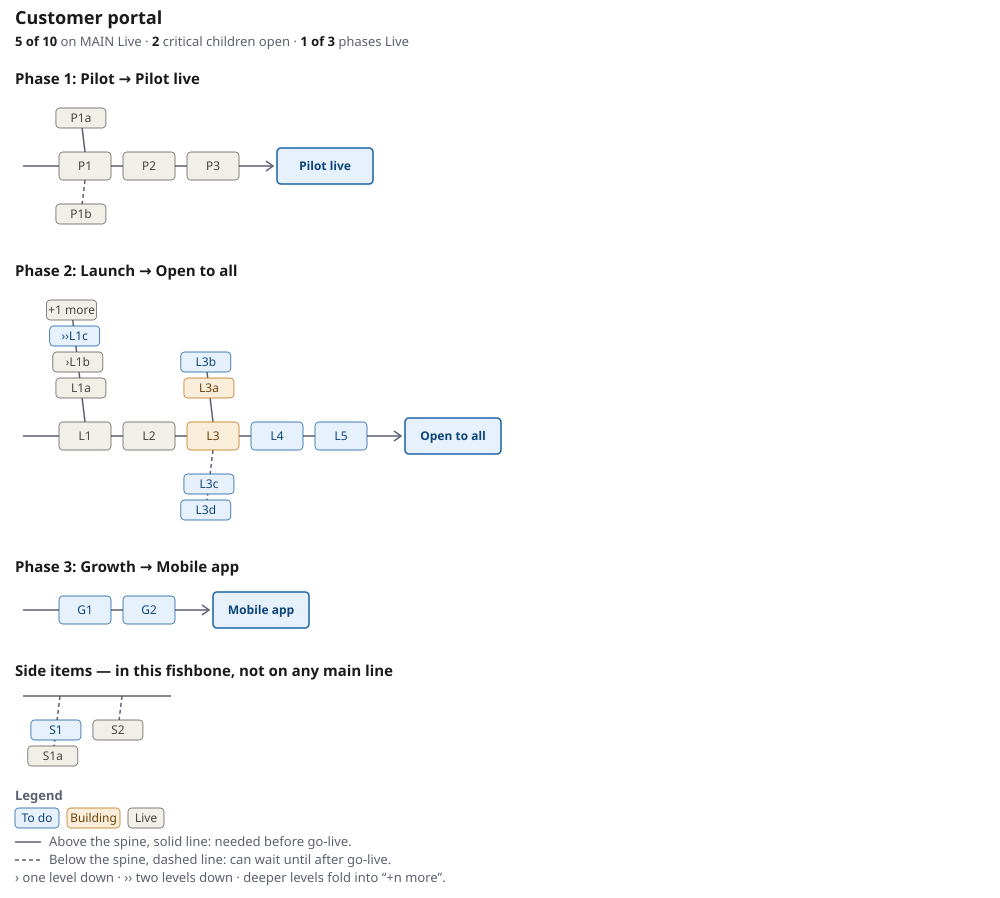

# Fishbone Generator

Give it one file that lists a plan's steps. It draws the **fishbone**: the steps in order on a line that ends in the goal, with the work found along the way hanging off each step — above the line if it is needed before the goal, below it if it can wait. Each box takes the colour of where its item stands.



## Three ways to use it

1. **The demo page** — <https://chalouhi.github.io/fishbone-generator/>. Drop, choose or paste a file; download the picture or a PDF. Your file never leaves your browser.
2. **The command**, for scripts and agents (Node 18 or later, no install step, no network):
   ```bash
   node bin/fishbone.js plan.json --svg plan.svg --pdf plan.pdf --width 1000
   ```
   A wrong file writes nothing, prints every problem and exits with 1.
3. **The script for your own page** — include one file and draw into any element, at its width:
   ```html
   <script src="src/fishbone.js"></script>
   <script>
     const result = Fishbone.draw(document.getElementById('plan'), fileText);
     if (!result.ok) console.log(result.errors);
   </script>
   ```
   It draws inside the element only and changes nothing else on the page.

## The file

JSON (or the same content as XML). The smallest one:

```json
{ "fishbone": 1, "title": "Kitchen refit", "golive": "Kitchen in use",
  "steps": [ { "id": "1", "name": "Agree the layout", "stage": "Live" },
             { "id": "2", "name": "Order the units", "stage": "Building" },
             { "id": "3", "name": "Fit and connect" } ] }
```

Everything else — children, before or after go-live, phases, side items, links, your own stages and colours — is in the **[file-format guide](docs/file-format.md)**. The five files in [`samples/`](samples/) show each feature.

## What is in this repository

| Folder | |
|---|---|
| `src/` | The tool: `fishbone.js` (reader, drawing, picture, page view) and `pdf.js` (the PDF). |
| `bin/` | The command. |
| `index.html`, `demo/` | The demo page. |
| `docs/` | The file-format guide. |
| `samples/`, `expected/` | The five sample files and the pictures and messages they must produce. |
| `reference/` | Pictures of three real fishbones frozen from the drawing this tool replaces, and the data they were made from (card numbers only). From 768 points wide up, the tool must draw them exactly. |
| `vendor/`, `fonts/` | pdf-lib and fontkit (MIT) and the Carlito font (SIL OFL 1.1), kept here so nothing needs a network. |
| `tests/` | `node --test tests/*.test.js` — every sample against its picture, the 12 reference pictures, the seven messages of the broken file, the PDF and the command. Browser tests of the demo page: `tests/browser/`. |

MIT licence.
